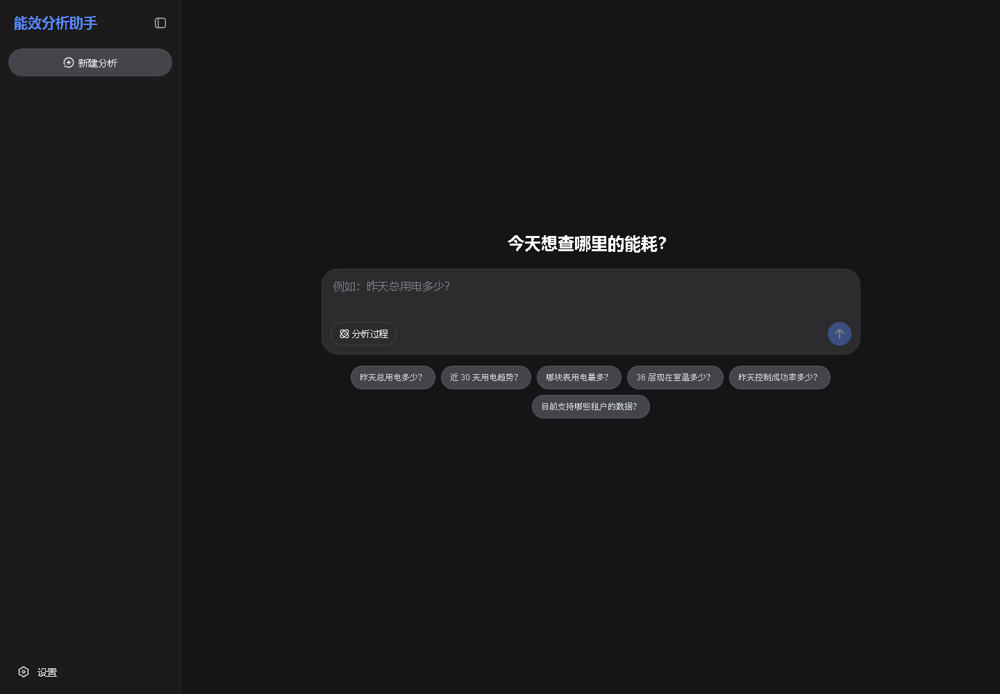
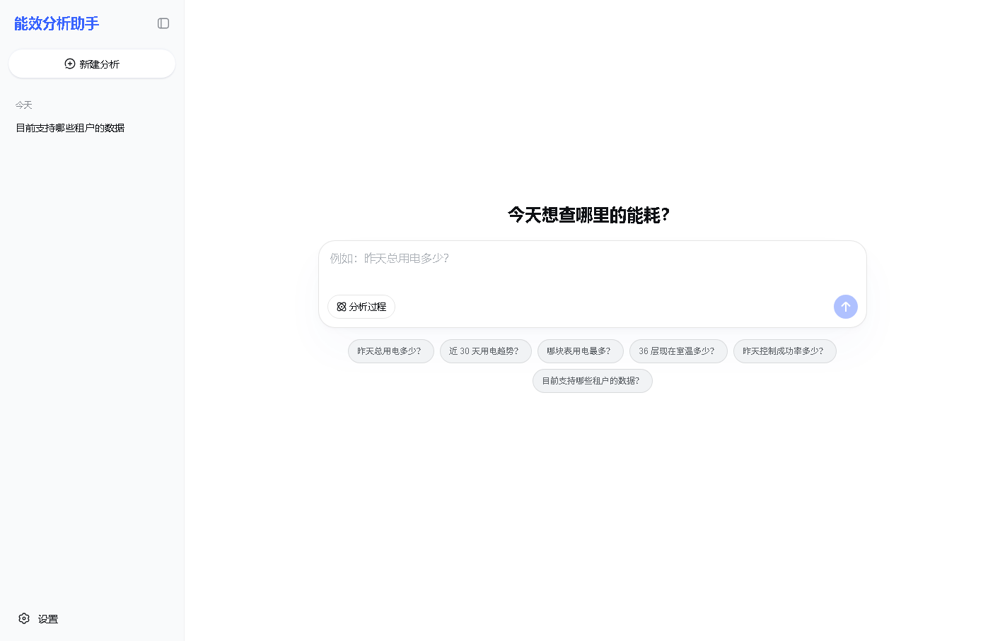

# 能效 Agent（chat-demo + BFF）

基于 DeepSeek 官方 `chat-demo` 改造的能效分析助手：

- **前端** `web/`：保留原 demo 的多会话、流式输出、Markdown/表格、主题、历史记录等能力；
- **BFF** `server/`：FastAPI，对前端暴露 Anthropic Messages 兼容 SSE，负责鉴权、意图解析、固定 SQL 模板、通过 `/archery` 技能只读查询 Doris/MySQL、以及固定模板未覆盖时的多源模型只读调查；
- **模型**：通过用户提供的 Anthropic 兼容代理调用 `deepseek-flash`，Key 只存在服务端 `.env`。

```text
浏览器 web (8090/8091)
   │  POST /anthropic/v1/messages  (SSE)
   ▼
BFF server (8088)
   ├─ 指标语义层：问题 → metric / entity / analysis / time 计划
   ├─ 规则意图 + 时间解析（明确命中口径的指标走固定模板）
   ├─ 固定模板 → Archery 只读技能（或 mock）
   ├─ 自主调查（tool loop）：模型分析问题 → 选工具 → 观察 → 修正 → 结论
   │    ├─ 工具：metric / run_sql / find_tables / search_columns / table_profile / describe_table
   │    │        knowledge / read_code / tenants
   │    └─ Doris/MySQL 双源 + SQL Guard + Archery 审计 + 租户/库隔离/时间/行数限制
   ├─ DeepSeek 代理（语言组织 / 工具决策 / 结论）
   └─ Anthropic SSE → 前端（真实工具步骤作为 thinking 推送）
```

## 指标语义层

`server/semantic.py` 负责把“用户的问法”映射成可执行指标，而不是把所有问题压成一个 `intent`：

```text
问题
  → MetricDefinition（指标/数据源/表/join/口径/单位/新鲜度）
  → QuestionPlan（metric + entity + analysis + time）
  → 固定 SQL 执行器 / 开放调查
```

当前已注册的指标包括：总用电、趋势、表计排名、用电异常、冷站配置、冷站用电、设备数量、表计数量、设备+表计数量、控制成功率、告警统计、小时表完整性。`GET /knowledge` 的 `metrics` 字段会返回指标字典。

几个关键边界：

- “冷站配置”和“冷站用电”是两个指标，不能都走 `eo_energy_saving_cooling_base_configs`；
- “冷站用电”必须把冷站设备映射到 `energy_type='electric'`、`meter_status=2` 的电表，冷量计不能当电表；
- 没有配置/没有电表映射/没有数据/不是 0，四种情况分别回答；
- “用电异常”只做前 7 天日均基线比较，明确说明不是因果归因；
- 当天日表未完整时，不拿半天数据判断“今天异常”；
- 设备数量、表计数量、设备+表计数量走固定计数，不再让模型多步调查。

语义层先用可测试的规则注册表，不把指标口径交给模型自由发挥；后续可以让模型只输出 `QuestionPlan`，执行仍由注册表和 SQL 校验器完成。

## 界面



浅色主题下快捷问题会使用浅色底、深色文字，不再出现白底硬编码：



## 目录

```text
energy-agent/
├─ web/                 # React 18 + rspack + Zustand + IndexedDB
│  ├─ src/
│  └─ rspack.config.ts  # __API_ORIGIN__ 注入
├─ server/              # FastAPI BFF
│  ├─ app.py            # /models、/tenants、/knowledge、/anthropic/v1/messages、SSE
│  ├─ semantic.py       # 指标语义层：指标定义 + 问题计划 + 歧义检测
│  ├─ agent.py          # 路由、固定模板、时间解析、答案组织
│  ├─ investigator.py   # 自主调查循环：分析 → 选工具 → 观察 → 收口
│  ├─ toolbox.py        # 工具注册表：metric/run_sql/find_tables/search_columns/
│  │                    #   table_profile/describe_table/knowledge/read_code/tenants
│  ├─ schema_cache.py   # 库表结构快照缓存（information_schema，6h TTL，落盘）
│  ├─ sqlguard.py       # 只读 SQL 校验（investigator 与 toolbox 共用）
│  ├─ test_investigator.py # SQL Guard / 小时表答案单测（不连库）
│  ├─ test_semantic.py  # 指标语义层单测（不连库）
│  ├─ test_agent_tools.py # 工具 + 调查循环单测（不连库、不调真实模型）
│  ├─ smoke.py          # 对话冒烟脚本（直连 BFF 题库）
│  ├─ tenants.py        # 租户 ↔ MySQL/Doris 库映射
│  ├─ providers.py      # ArcheryProvider（Doris）/ MySQLArcheryProvider / MockProvider
│  ├─ knowledge.py      # 代码逻辑 + 库表知识库 / GET /knowledge
│  ├─ concepts.py       # 业务口径知识：怎么算/是什么/流程/区别 + 本项目数据情况
│  ├─ test_concepts.py  # 业务口径路由单测（不连库）
│  ├─ test_scop.py      # 冷站 SCOP 名称归集单测（不连库）
│  ├─ test_columns.py   # 字段元数据检索单测（不连库）
│  ├─ test_profile.py   # 表画像/真实库兜底单测（不连库）
│  ├─ test_schema_cache.py # schema 快照缓存 + 自适应步数单测（不连库）
│  ├─ llm.py            # 模型客户端：Anthropic / OpenAI 双协议
│  ├─ model_config.py   # 设置页模型配置的读写与脱敏
│  ├─ test_model_config.py # 模型配置单测（不连网）
│  ├─ config.py
│  └─ .env              # 本地配置（已 gitignore）
├─ docs/
│  └─ 能效Agent知识库.md  # 表、字段、关系、SQL 模板、边界
└─ README.md
```

## 一键启动（Windows）

```powershell
powershell.exe -NoProfile -ExecutionPolicy Bypass -File "E:\Desktop\zuolin\energy-agent\start.ps1"
```

脚本会检查 8088/8090 端口：未启动则拉起 BFF 和前端，已启动则直接复用，不会重复起进程。
日志在 `logs/bff.err.log`、`logs/web.err.log`；`start.ps1` 同时支持 `CHAT_WEB_PORT` 环境变量。

回归：`python logs/golden_questions.py` 跑 12 道黄金问题（SCOP/室温/告警/租户/口径），
结果写入 `logs/golden-report.txt`（2026-11-19 实测 12/12，平均 17.8s）；单测在 `server/` 下执行：
`python -m unittest test_schema_cache.py test_scop.py test_columns.py test_profile.py test_concepts.py test_agent_tools.py test_investigator.py test_semantic.py test_model_config.py`（当前 71 个）。

## 1. 启动 BFF

```powershell
cd "E:\Desktop\zuolin\energy-agent\server"
python -m pip install -r requirements.txt
python -m uvicorn app:app --host 127.0.0.1 --port 8088
```

健康检查：

```powershell
curl.exe http://127.0.0.1:8088/health
```

默认读取 `server/.env`。关键配置：

```dotenv
# 模型代理：anthropic 追加 /v1/messages，openai 追加 /v1/chat/completions
LLM_BASE_URL=http://127.0.0.1:18786/llmproxy/anthropic
LLM_PROTOCOL=anthropic
LLM_API_KEY=<appkey>
LLM_MODEL=deepseek-flash

# 前端访问 BFF 的令牌；生产环境换成 SSO/网关鉴权
BFF_TOKEN=energy-demo-token

# archery：通过 Archery 技能只读查询（本项目默认，不直连 Doris/MySQL）
# mock：仅离线演示
DATA_PROVIDER=archery

# Doris 分析库（通过 Archery）
ARCHERY_INSTANCE=数智能效saas现网-doris
ARCHERY_HELPER_DIR=C:\Users\2025\.dsh\skills\archery
DORIS_DB=nwdy_dm
DORIS_TENANT_ID=1026
DORIS_PROJECT_ID=1

# 线上 MySQL 业务库（同一个 Archery 实例，只切换 db_name）
MYSQL_ENABLED=true
MYSQL_ARCHERY_INSTANCE=数智能效saas现网
MYSQL_DB=nwdy
```

模型代理探活：

```powershell
curl.exe http://127.0.0.1:8088/health/llm
```

### 在设置页切换模型

前端「设置 → 模型」可直接改 API 地址、协议、模型名和 API Key，保存后立即生效，无需重启 BFF：

- 支持 **Anthropic Messages**（`/v1/messages`）与 **OpenAI Chat Completions**（`/v1/chat/completions`）两种协议；
- 「获取可用模型」调用 `GET {API 地址}/v1/models` 拉取模型列表，选中即可填入；
- 配置落盘到 `server/model_config.json`，优先级高于 `.env`，Key 只上行不回显；
- 删除该文件并重启 BFF 即回到 `.env` 默认配置；
- 相关接口：`GET/PUT /model/config`、`POST /model/probe`（探测不落盘）。

## 2. 启动前端

```powershell
cd "E:\Desktop\zuolin\energy-agent\web"
pnpm install
pnpm dev
```

打开 `http://localhost:8090/`。

如果 8090 已被占用：

```powershell
$env:CHAT_WEB_PORT='8091'
pnpm dev
```

开发模式下前端默认请求 `http://127.0.0.1:8088`；如需改地址：

```powershell
$env:CHAT_API_ORIGIN='http://127.0.0.1:8088'
pnpm dev
```

## 3. 通过 Archery 技能查询线上 Doris / MySQL

本项目**不建立 Doris 或 MySQL 直连**，也不读取 `DORIS_HOST` / `DORIS_USER` /
`DORIS_PASSWORD` / `MYSQL_HOST` / `MYSQL_PASSWORD`。
所有数据库查询都通过 `/archery` 技能的 `archery_api.py` 执行：

```dotenv
DATA_PROVIDER=archery
ARCHERY_INSTANCE=数智能效saas现网-doris
ARCHERY_HELPER_DIR=C:\Users\2025\.dsh\skills\archery

# 逻辑库名/租户过滤，不代表直连地址
DORIS_DB=nwdy_dm
DORIS_TENANT_ID=1026
DORIS_PROJECT_ID=1
DORIS_ENERGY_TYPE=electric

# 线上 MySQL 业务库：同一个 Archery 实例，仅切换 db_name
MYSQL_ENABLED=true
MYSQL_ARCHERY_INSTANCE=数智能效saas现网
MYSQL_DB=nwdy
```

运行时：

1. `ArcheryProvider` 负责 Doris 固定指标模板；
2. `MySQLArcheryProvider` 负责线上 MySQL 业务库，库名按租户切换（`nwdy`、`rongyao` 等）；
3. 两者都导入技能目录下的 `archery_api.py`，复用
   `C:\Users\2025\archery_config.txt` 的 Session 登录；
4. 都调用 Archery 的 `/query/` 只读接口，查询进入 Archery 审计；
5. 固定模板未覆盖的问题，由 `investigator.py` 的自主调查循环处理：
   模型先分析问题，再自己选工具（查表结构 / 查口径知识 / 读代码 / 跑固定指标 / 跑只读 SQL），
   观察结果后继续推理，最后给出结论；一个回答内可以连续执行多步工具调用。

开放调查的强制边界：

- 只允许 `SELECT` / `WITH` / `SHOW` / `DESC`，单语句、无注释、无系统库；
- `SELECT` 必须使用当前数据源库的全限定表名；
- 有 `tenant_id` 的数据源必须带 `tenant_id = 当前租户`；MySQL `eo_ticket` 没有该列，
  按每租户独立库隔离；
- 事实表必须带时间过滤；MySQL 告警/控制/抄表/工单分别用
  `alarm_time` / `create_time` / `reading_time` / `created_at`；
- 不允许引用其它租户库（如查询 `nwdy` 时出现 `rongyao.` 会直接拒绝）；
- 最多 200 行、最多 8 步工具调用、单次工具 60 秒超时；
- 查询结果压缩后回填（单次最多 20 行展示），避免上下文膨胀；
- 每次 SQL 仍通过 Archery 只读接口，进入 Archery 审计；写操作全部拒绝；
- 模型如果无法确认表结构或结果，必须明确说“无法判断”，不能拿别的指标替代。

注意：

- 数据库密码只存在于 Archery 技能配置，不写入项目和前端；
- 查询全程可审计，写操作仍走 Archery 网页工单；
- 固定模板查询都带 `tenant_id`、`project_id`、时间范围和 `LIMIT`；
- 开放调查的 SQL 由模型生成，但会先经过 SQL Guard，且只读、租户/库隔离、限行。

### 与 `deepseek-harness` Agent Loop 的关系

参考了 `deepseek-harness-master/packages/core/agent-loop` 的核心思路，但没有整套 TypeScript 移植：

- **turn / step 循环**：模型先决定下一步，再执行工具，观察结果后进入下一步；
- **工具调用与观察**：工具不再只有 SQL，结果压缩后回填，避免把整库结果塞进上下文；
- **上限与收口**：最多 8 步；达到上限先强制 JSON 收口，失败再要一次纯 Markdown 结论；
- **统一 Guard**：模型不能绕过只读、租户/库隔离、时间过滤和限行；
- **会话上下文**：从同一会话 `messages` 提取上一轮问题/回答/租户/时间，不把历史数字当成本轮结果。

没有引入 Harness 的完整 session/compaction 运行时；但工具层已经按“注册表 + 统一校验 +
观察压缩 + 上限收口”实现，新增工具不需要改循环本身。

### 自主工具调查（tool loop）

固定模板只回答“明确命中口径”的问题。出现下列情况时，`agent.py` 会把问题交给
`investigator.py` 的循环（`AGENT_TOOL_LOOP=true` 时）：

- 问题要求模板没有的维度：按楼层/空间/设备分组、两个对象对比、告警/控制的类型分布；
- 语义层没有命中任何指标（例如“多少台空调面板”“哪些设备一直在运行”）；
- 明确要求查 MySQL 业务库；
- 固定模板返回空表/不可用（例如告警表为空、室温全是 0、排名 0 行）——会先换路径再下结论。

工具清单（全部只读，统一经过 `sqlguard.py` 或服务端固定 SQL）：

| 工具 | 作用 | 参数 |
|---|---|---|
| `metric` | 已注册指标的固定口径 | `metric` + `start`/`end`/`keyword` |
| `run_sql` | 只读 SQL（强制校验） | `source`(doris/mysql) + `sql` |
| `find_tables` | 按关键词找表；精选目录不命中时自动按字段名/注释回查真实库（快照优先） | `keyword`、可选 `source` |
| `search_columns` | 按字段名/注释搜表和字段；优先读 schema 快照，没快照时实时查并后台建快照 | `keyword`、可选 `source`、`refresh` |
| `table_profile` | 表画像：行数、时间范围、租户数、是否空表 | `table`、可选 `source` |
| `describe_table` | 看真实字段/类型/注释 | `table`、可选 `source` |
| `knowledge` | 查本地库表知识/指标口径/边界 | `query` |
| `read_code` | 读项目代码与文档（白名单） | `query`，可选 `path` |
| `tenants` | 租户与库映射 | 无 |

`metric` 除了固定指标，还提供两个面向“维度问题”的指标：

- `floor_energy`：按 `meter_name` 正则解析楼层并聚合用电，返回覆盖率、未识别电量；
  楼层排名/楼层对比优先用它，结论必须写“按表计名解析、覆盖率 X%”；
- `space_energy`：按 `space_name/space_code` 聚合用电，并返回空间覆盖数。
  只有 `A1座` 一个分组时会明确说明“楼层未拆分”，不允许拿表计排名冒充楼层排名；
- `device_readings`：按设备名称/空间汇总点位（室温、压力、开关机等），
  服务端先用设备台账按租户筛 `device_id` 再关联点位表；
  返回 `active_hours`（窗口内出现过的小时数）；
- `running_devices`：窗口内持续运行的设备。按 `FanStartSwitchSp/ModeSp/ActivePowerSum`
  的活跃小时占比（默认近 168 小时、占比 ≥ 0.8）排序，结论里会写明判据和窗口；
- `cold_station_scop`：冷站 SCOP = 冷量 ÷ 用电，按冷站配置 + 冷量计 + 电表名称归集，
  返回每个冷站的冷量/用电/SCOP/状态（电表≈0 标记“电量存疑”）；
- `cold_station_devices`：按冷站统计设备分类台数（冷机/冷冻水泵/冷却水泵/冷却塔等）。

为什么点位表要单独做工具：`dwi_eo_d_point_data` 没有 `tenant_id`，如果允许模型直接写 SQL，
要么无法带租户过滤（有越权风险），要么所有查询都被 Guard 拒绝。工具内部按
`dim_eo_d_device.tenant_id` 先筛设备，既安全又能一次查完。

**schema 快照缓存**：第一次 `search_columns`/`find_tables` 需要元数据时，先实时查
`information_schema` 返回结果，同时在后台把该库的“表清单 + 字段名/类型/注释”抓成
快照（`server/.cache/schema/<source>-<database>.json`，6 小时 TTL）。之后的字段检索
0 秒命中；`refresh:true` 可强制重建。快照只是索引，不缓存业务数据。

**自适应步数**：常规问题最多 8 步就必须收口；只有用过 `search_columns`/`table_profile`
的发现类问题才允许继续到 12 步，避免简单问题跑满预算。

循环失败时的兜底顺序：

1. 模型输出 final → 直接用；
2. 达到步数上限 → 强制 JSON 收口；失败则再要一次纯 Markdown 结论；
3. 仍然失败 → 用已执行的查询结果拼结构化回答（不再输出原始 JSON 行）；
4. 固定模板本身不可用 → 确定性说明（例如“告警表为空≠0 条告警”），不交给模型润色。

配置：

```dotenv
AGENT_TOOL_LOOP=true        # false 可退回“只走固定模板”的保守模式
AGENT_MAX_STEPS=12          # 单次调查最多工具步数（3~12）；常规问题 8 步收口
ANSWER_STREAM_SECONDS=8     # 回答逐行输出的目标总时长；0=一次性输出
```

前端看到的是真实步骤：每执行一个工具，BFF 通过 SSE 的 `thinking_delta` 推送
“查找表 / 读取表结构 / 查询指标 / 执行只读 SQL / 汇总结论”，不再是预置文案。

最终回答按 Markdown 行逐行推送（`text_delta`），默认用 8 秒铺完：短回答很快、
长回答也不会一次性刷屏，滚动条是渐进下移而不是瞬间到底。单行最短 25ms、
最长 180ms；把 `ANSWER_STREAM_SECONDS` 设为 0 可恢复一次性输出。

## 4. 已实现的能力

| 能力 | 数据来源 | 说明 |
|---|---|---|
| 期间总用电量 | `dm_eo_e_meter_di` | 日粒度，kWh |
| 日用电趋势 | `dm_eo_e_meter_di` | 最多 400 天，默认近 7 天 |
| 表计用电排名 | `dm_eo_e_meter_di` | Top 10 |
| 设备室温/设定温度 | `dwi_eo_d_point_data` | 最近 2 小时有上报的设备 |
| 控制任务统计 | `eo_device_control_task` | status 2=成功、3=失败 |
| 告警统计 | `dim_eo_alarms` | 视租户接入情况 |
| 小时表缺数/完整性 | `dm_eo_e_meter_hi` | 单日已结束整点覆盖，按小时统计行数/表计数 |
| 线上 MySQL 业务库 | MySQL `<租户code>` | 设备、表计、空间、控制任务、告警、工单、电价等，多步只读分析 |
| 冷站配置 | MySQL `eo_energy_saving_cooling_base_configs` | 冷站名称、cold_site_id、空间、日历、冷站类型 |
| 开放数据调查 | Doris + MySQL | 模型自己查表结构/口径/代码，再选指标或只读 SQL 多步排查 |
| 楼层/空间用电 | `dm_eo_e_meter_di` | 按 `space_name` 聚合，并说明楼层覆盖是否足够 |
| 设备持续运行 | `dwi_eo_d_point_data` | 按活跃小时占比判断哪些设备一直在运行 |
| 字段与口径自证 | MySQL + Doris + `knowledge.py` | 可 `describe_table` 看真实字段，也可 `read_code` 核对实现 |
| 租户与数据库关系 | `energyOperation.eo_tenant_data_sources` | 租户名称/ID/编码、MySQL/Doris 库 |
| 代码与库表知识 | `server/knowledge.py` | 指标对应哪张表、哪些字段、什么口径 |
| 业务口径知识 | `server/concepts.py` | “怎么算/是什么/流程/区别”直接给定义、公式、本项目数据情况和边界，不跑 SQL |
| 能力边界 | 内置 | 明确不能查同比、节能率、房间级能耗等 |

### 租户与库关系

`GET /tenants` 返回当前接入的 15 个租户，以及每个租户的 MySQL 库和 Doris 库。

业务方提供的租户名称映射：

```text
中集安瑞科 = zjark_1      双汇 = shuanghui       晶安高科 = jagk
中交城投 = zjct          秦龙电力 = qldl         楚天龙 = ctl
西峡众德 = xxzd          南网能源 = nwdy         荣耀 = rongyao
亨通 = hengtong          楚江 = chujiang
```

`shby / musi / sgyy / nxys` 四个租户暂未提供名称，回答中显示“未提供”，不猜测客户名称。

```text
租户 1026 / 南网能源 / 编码 nwdy / MySQL nwdy / Doris nwdy_dm / 当前
```

约定：

- 租户编码 = MySQL 库名；
- Doris 库名 = 租户编码 + `_dm`；
- 目录当前是静态维护的（来自 `eo_tenant_data_sources` 的 `tenant_id + db_name` 去重结果），
  新增租户时同步更新 `server/tenants.py`；
- 当前会话默认使用 `.env` 里的 `DORIS_TENANT_ID` / `DORIS_DB`；
  开启 `ALLOW_TENANT_QUERY` 后，会按用户问题里的租户名重建 Doris 和 MySQL provider；
- 用户问题里的租户名会被识别（如“荣耀”），并同时切换 `rongyao_dm` 和 `rongyao` 两个库；
- 生产切租户仍必须由网关注入身份，不能由模型传 `tenant_id`；`ALLOW_TENANT_QUERY` 只是功能开关。

### 按租户查询的开关

按需求，跨租户查询**默认开启**：

```dotenv
DATA_PROVIDER=archery
ALLOW_TENANT_QUERY=true
```

开启后，BFF 会按 `tenants.py` 中的 `tenant_id`/`doris_db`/`mysql_db` 创建对应租户的
`ArcheryProvider` 和 `MySQLArcheryProvider`，再通过 Archery 查询该租户的 Doris/MySQL 库。
`DATA_PROVIDER=mock` 仍然只有南网能源演示数据，不能返回其他租户的真实读数。

注意：`ALLOW_TENANT_QUERY` 只控制“是否允许按问题切库”，本身不是鉴权。当前 BFF 还没有读取
`X-Tenant-Id`，生产必须由网关/SSO 先完成租户身份校验；如果需要恢复严格隔离，把它设为
`false` 即可。

聊天里可以直接问：**“目前支持哪些租户的数据？”**，会返回完整映射表；
也可以问：**“查询一下租户荣耀的今日用电数据”**，会按荣耀库取数。
冷站配置可以问：**“南网能源配置了哪些冷站？”**，会直接查
`nwdy.eo_energy_saving_cooling_base_configs`；当前实测为 0 条，会明确回答“没有配置冷站”，
不会用设备名称猜。

### 会话记忆与追问

前端同一会话会把历史 `messages` 一起发给 BFF；`agent.py` 从历史中提取上一轮的指标、
时间、租户和楼层，支持自然追问：

```text
南网能源昨天总用电多少？ → 那今天呢？
南网能源昨天总用电多少？ → 那荣耀呢？
荣耀昨天总用电多少？     → 那今天呢？
南网能源 36 层室温多少？ → 那 37 层呢？
南网能源昨天控制成功率？ → 那前天呢？
```

也支持问“我刚才问了什么”“上一轮你怎么回答的”“我们聊了什么”。记忆只来自当前会话
携带的历史消息，不做跨会话的用户画像。

### 代码与库表知识库

完整知识库在 [`docs/能效Agent知识库.md`](docs/能效Agent知识库.md)，运行时可检索版本在
[`server/knowledge.py`](server/knowledge.py)（库表与代码）和
[`server/concepts.py`](server/concepts.py)（业务口径：冷站 COP、分项、需量、电价、面积、
碳排、告警/工单流程、倍率、同步链路等）。

```text
浏览器 → 聊天接口 → intent=knowledge → knowledge_answer()
```

可以直接问：

- 昨天总用电查哪张表、哪些字段？
- 室温数据来自哪张表？
- 控制成功率的 status 是什么口径？
- 租户和 Doris 库怎么对应？
- 这道题的代码调用链是什么？

`GET /knowledge` 返回结构化的表、字段、意图路由、表关系和代码链路；不包含数据库密码、
模型 appkey 或租户连接串。

## 5. 生产构建

```powershell
cd web
$env:CHAT_API_ORIGIN=''
pnpm build
```

构建产物在 `web/dist/`。生产默认同源，Nginx 把 `/anthropic/v1/` 和 `/models` 转发给 BFF：

```nginx
location /anthropic/v1/ {
    proxy_pass http://energy-bff:8088;
    proxy_buffering off;
    proxy_cache off;
    proxy_read_timeout 300s;
    proxy_set_header X-Accel-Buffering no;
}

location = /models {
    proxy_pass http://energy-bff:8088;
}

location = /tenants {
    proxy_pass http://energy-bff:8088;
}

location = /knowledge {
    proxy_pass http://energy-bff:8088;
}
```

SSE 必须关闭代理缓冲，否则前端会“一次性出现全文”。

## 6. 设计边界

- 前端不持有 DeepSeek Key，也不连接 Doris/MySQL；
- BFF 对已知指标只做模板查询；开放问题才允许模型生成只读 SQL，且必须经过 SQL Guard；
- MySQL 与 Doris 共用 Archery 只读通道，不保存 MySQL 主机/账号/密码；
- `dwr_eo_energy_meter_wide` / `dwi_eo_energy_usage` 是当日快照，不做趋势；
- `dm_eo_s_space_di` 有重复行，不能直接 `SUM`；
- 告警表为空时回答“不可用”，不能回答“0 条告警”；
- 租户目录用于识别“有哪些租户/库”；跨租户取数默认开启，由 `ALLOW_TENANT_QUERY` 控制，生产仍建议网关/SSO 先校验身份；
- 当前不支持同比/环比、节能率、房间级能耗、整栋总能耗、气象归一化、实时控制、跨日补数/采集值准确性；
- 工单可查 MySQL `eo_ticket` 明细，但闭环率/SLA 口径要按业务状态确认，无数据时不能编造；
- 小时表完整性当前只支持单日已结束整点覆盖，不把当前未结束的小时算成缺失。

## 7. 说明

- 前端基于 DeepSeek 官方 `chat-demo`（MIT），保留 `web/LICENSE`；
- 附件、语音、联网搜索、朗读按钮已隐藏/禁用；
- 本地演示令牌 `energy-demo-token` 只用于开发，生产必须替换为 SSO 或网关注入；
- `server/.env` 含模型 appkey，不要提交到 Git。
